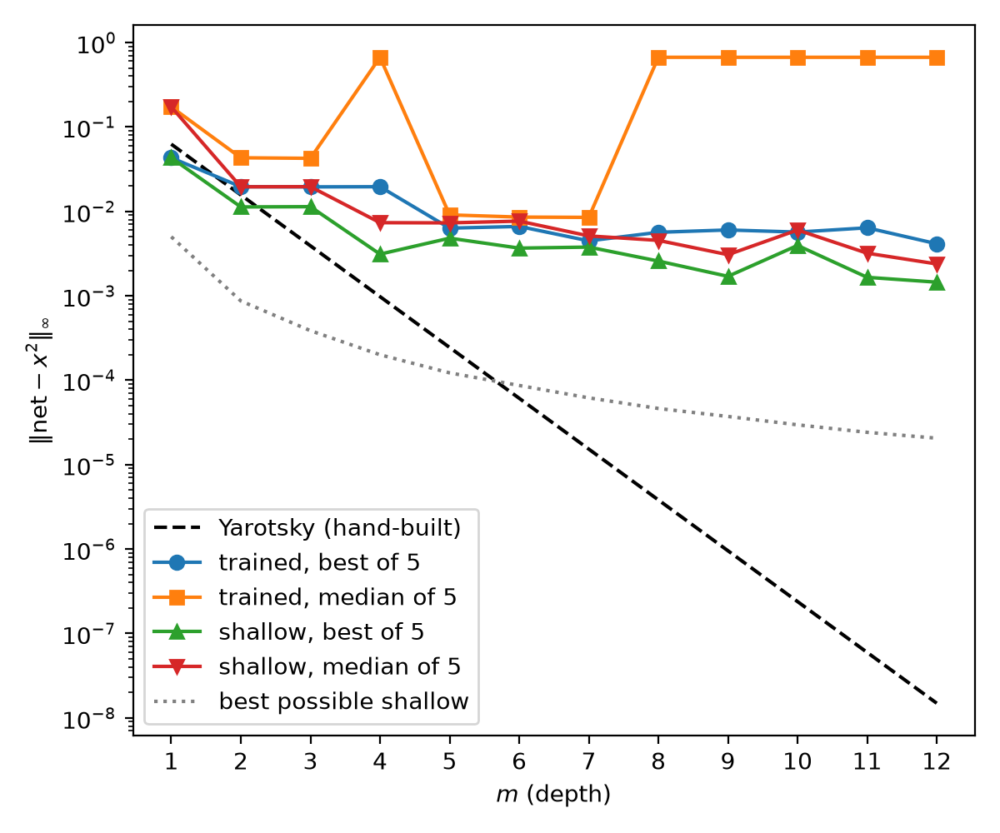
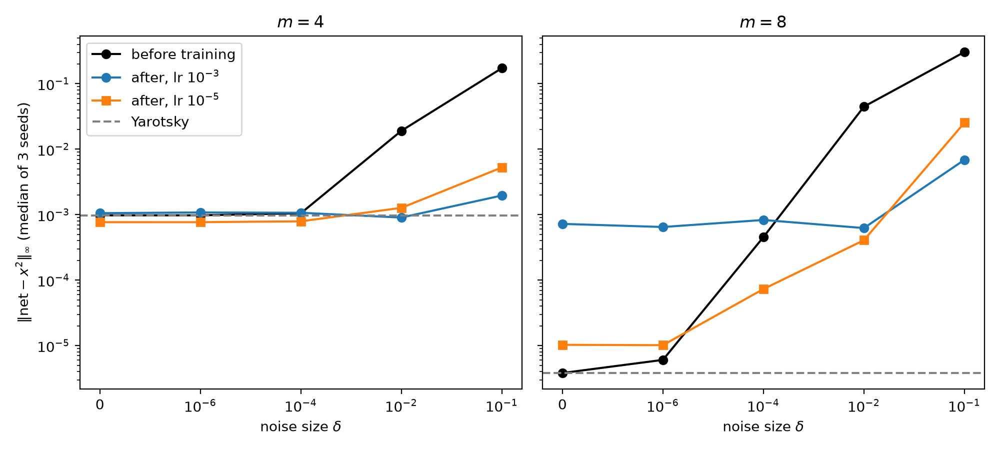

# Yarotsky's x² network: construction vs training

Yarotsky (2017) builds a ReLU network of width 4 and depth $m$ that approximates $x^2$ on $[0,1]$ with sup error $2^{-2m-2}$. Here I build that network by hand and check whether gradient descent can find it.

## Construction

With $\sigma(t) = \max(0,t)$ and the hat function $g(x) = 2\sigma(x) - 4\sigma(x - \tfrac12) + 2\sigma(x-1)$, let $g_s$ be $g$ composed $s$ times. Then

$$f_m(x) = x - \sum_{s=1}^m 4^{-s} g_s(x)$$

interpolates $x^2$ on the grid $k/2^m$, and $\|f_m - x^2\|_\infty = 2^{-2m-2}$. Each layer adds one sawtooth, so $f_m$ is a width-4 network with $m$ hidden layers.

## Code

- `sawtooth.py`: $g$, $g_s$ and a plot of $g_1, \dots, g_4$
- `yarotsky.py`: $f_m$ and a check of the error formula for $m \le 12$
- `network.py`: the network with hand-set weights; matches $f_m$ exactly
- `train.py`: trains the same architecture from random weights
- `shallow.py`: one hidden layer with the same number of weights
- `perturb.py`: starts training at Yarotsky's weights plus noise
- `plot.py`, `plot_perturb.py`: the figures

Training: 1000 uniform samples, MSE loss, Adam, 20 000 steps, float64. Errors are measured in the sup norm on $2^{16}+1$ grid points.

## Results

### Random starts



The trained deep network stops improving at around $5 \times 10^{-3}$ from $m = 5$, while the construction keeps gaining a factor of 4 per layer. For $m = 4$ and $m \ge 8$, most runs end with a constant output (sup error $\approx 0.67$): some layer has all its ReLUs off on $[0,1]$, so the gradients vanish.

A shallow network with the same number of weights trains better than the deep one at almost every $m$, and never dies, even though in theory the deep network wins from $m \approx 6$. Training gets nothing out of depth here.

### Starting near the construction



Training starts at Yarotsky's weights plus Gaussian noise of size $\delta$, with learning rates $10^{-3}$ and $10^{-5}$ and 3 seeds each.

- At $m = 4$, training stays at Yarotsky's error or improves on it. His construction isn't optimal: shifting it down by half its error halves the error.
- At $m = 8$ with learning rate $10^{-3}$, every run ends around $7 \times 10^{-4}$, even when it starts from the exact construction ($3.8 \times 10^{-6}$). With $10^{-5}$, the exact start only drifts to $10^{-5}$.

Adam moves each weight by roughly the learning rate per step, and the deep layers need precision of about $4^{-8} \approx 10^{-5}$. So the gap has two parts: random starts never reach the good region, and the step size limits how precise the network can be even when it starts there.

Note: training uses MSE while the comparison uses the sup norm, and the seed counts are small.

## Running

```
pip install -r requirements.txt
python train.py
python shallow.py
python perturb.py
python plot.py
python plot_perturb.py
```

## References

- D. Yarotsky, Error bounds for approximations with deep ReLU networks, Neural Networks (2017)
- B. Adcock, N. Dexter, The gap between theory and practice in function approximation with deep neural networks, SIAM J. Math. Data Sci. (2021)